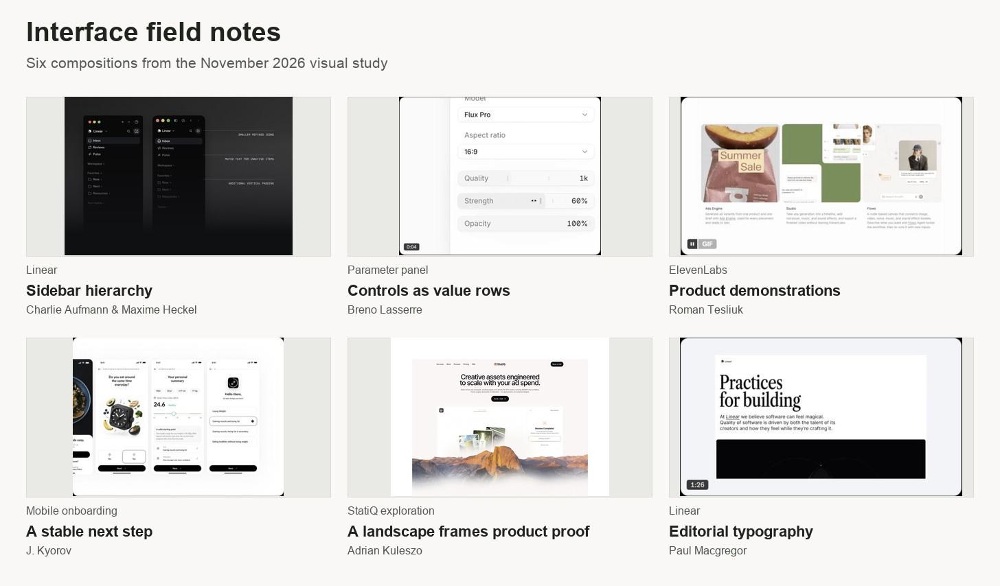

# Interface field notes · November 2026

Chrome fieldwork on November 17 started with the X For You timeline, continued through design accounts in Following, then followed credits, recommendations, replies and links to designers’ working resources. This is a deliberately selected sample. A launch reel can establish a visual relationship. Its frame rate, cropped labels and ideal copy tell us little about the shipped experience. The 21 specimen images are crops of Chrome screenshots. Two show keyboard states operated in a live component demo. The remaining images show published work, including frames from videos. Source media belong to their creators.

## Pull up a working reference

The theme study also includes [light](specimens/theme-product-light.jpg) and [dark](specimens/theme-product-dark.jpg) product crops from the [recording](specimens/theme.jpg). They retain the original resolution. Use these two regions to see what leads inside each product viewport and where the next section begins. The presenter, player and mode captions belong to the recording.

From the skill directory, run `node scripts/specimens.mjs --task workspace` for matching sources, full-size image paths and checks. Open the images before committing to a direction. Use `--list` to discover tasks and specimen IDs. To make a portable board for a brief, run `node scripts/specimens.mjs --task landing --out /tmp/landing-references.html` with a fresh output path. Omitting the filter includes all 17 studies. For generation, use the [source-to-render workflow](../../workflow/agent-prompting.md#generate-from-a-field-specimen) to design the primitives, compose the page and put its rendered screenshot beside one selected source.

## Choose by the job in front of you

| When the user is… | Look at | Carry into the product | Check on the implementation |
| --- | --- | --- | --- |
| Scanning or returning to work | Linear sidebar and mobile review | Steady icon and text columns, quiet navigation, one legible current location | Compare shared edges at one nesting depth. Navigate by keyboard and find the current item in each theme. |
| Comparing a number while editing it | Breno’s slider and Allo’s data specimens | Persistent label, value and unit, even as the control changes | Drive minimum, maximum and reversal. Match the displayed value to the real control and measure the edge that should stay still. |
| Discovering a tool | Micka’s grouped tooltip and Nitish’s status picker | Bind the hint or status to its object. Keep focus visible through the handoff. | Move forward twice, reverse, dismiss. Inspect the association, final geometry and focus. |
| Reviewing a proposed change | Carl’s Daybook and Yağız’s inline editor | Keep the original in reading position and place a proposal or action beside it | Change a partial selection, inspect the scope, reject, then accept another change. |
| Learning a sequence | J. Kyorov’s onboarding | Progress and action stay familiar while the center takes the form the step needs | Use long copy and a short viewport. Return to the previous step and verify the selected answer. |
| Deciding what a feature does | Roman’s feature cards and Lorenzo’s deck | Give each feature a recognizable demonstration in a stable captioned slot | Compare still and active states. Interrupt and reverse. Read the caption with motion off. |
| Reading an offer or a brand story | StatiQ and Paul Macgregor’s Linear reel | Let type, imagery and pacing carry identity at a scale appropriate to reading | Capture real headlines at narrow widths. Inspect crop, wrap and the relationship to the next action. |
| Recovering from no results | Kevin’s empty states | One small object, a precise explanation and a relevant recovery action | Try the original query, empty result and recovery. Check the path on touch with no hover. |

Choose an example for a particular relationship. Open its specimen at working size, then inspect the whole host screen. A useful brief names the part to preserve and the condition that might break it. For example, “Keep the file name in reading position when review metadata expands. At phone width the metadata can wrap underneath.” A reference helps decide what to try. The target product supplies the dimensions, type roles and tolerances.

## Linear’s product and brand have different jobs

**Desktop shell.** The light annotation exposes several adjacent vertical guides. Icons occupy their own column, repeated labels share a start edge, and header utilities have an end track. Alignment follows nesting depth. The March dark comparison makes a different intervention. Inactive navigation carries less contrast, glyphs become smaller, and rows gain vertical breathing room. A dark selected band and clear label keep the current destination recognizable. Study the divider and the empty space on either side together. Lowering the contrast of everything would weaken the same hierarchy the refresh set out to establish. [Annotated guides](specimens/linear-tracks.jpg) · [Dark before/after](specimens/linear-shell.jpg) · [Karri’s critique](https://x.com/karrisaarinen/status/2119321203076977020) · [Yann’s account of the work](https://x.com/yannglt/status/2119742770764210298) · [Charlie Aufmann and Maxime Heckel’s case study](https://linear.app/now/behind-the-latest-design-refresh)

**Mobile review.** Adrien Griveau’s two dark screens use quite different densities inside the same shell. The guide has a step count, a sentence-case heading and a short account of the change. Below it, filenames, additions, deletions and review boxes snap into compact rows. The other screen collects branch and reviewer metadata above a distinct merge control at the bottom. The green/red values already have signs. For a narrow review, protect the identity of the change, its position in the sequence and the scope of the commitment. Stress the longest filename, a missing preview and a pending check. A static mock gives no evidence of actual hit areas or merge behavior. [Mobile specimen](specimens/linear-mobile.jpg) · [Adrien’s post](https://x.com/Griveau/status/2121169976363307276)

**Editorial Linear.** In Paul Macgregor’s reel, an oversized black serif heading breaks across two short lines. A small mark, a narrow sans-serif paragraph and a wide dark image give it a reading sequence. Bringing that scale into a review inbox would crowd out the work. For a manifesto, try the opposite test: remove the headline scale and inspect whether the composition still has an entry point. Paul also published a higher-quality reel and a frame-by-frame Figma version. [Editorial frame](specimens/linear-brand.jpg) · [Original reel](https://x.com/pdotcv/status/2121337054877601914) · [Figma walkthrough post](https://x.com/pdotcv/status/2122282262955769963) · [Designer’s reel](https://p.cv/2y/)

### Linear people and working resources

| Person | Why open this source |
| --- | --- |
| [Yann-Edern Gillet · @yannglt](https://x.com/yannglt) | Software designer credited on the UI reset. His own site documents internal tools for populating mockups, managing themes and icons. His moodboard includes cameras, keyboards, signage and a newspaper masthead. Pick a physical reference for a property such as silhouette or lettering. His Framer plugin transfers Figma color styles. Confirm the role of the color in both themes after transfer. [Working tools](https://yannglt.com/now) · [Moodboard](https://yannglt.com/moodboard) · [Framer/Figma Sync](https://www.framer.com/marketplace/plugins/framerfigma-sync/) |
| [Charlie Aufmann · @charlieaufmann](https://x.com/charlieaufmann) | Co-authored the refresh with engineer Maxime Heckel. The team put theme controls and a before/after toggle in the working app. Compare the same route, data and selection when evaluating a palette or chrome change. [Design credit](https://linear.app/now/author/charlie-aufmann) · [Team’s method](https://linear.app/now/behind-the-latest-design-refresh) |
| [Adrien Griveau · @Griveau](https://x.com/Griveau) | Posts first-person examples from Linear’s mobile reviews. Use the review screen above for task-specific information hierarchy. [Mobile work](https://x.com/Griveau/status/2120933886607729073) |
| [Conor Muirhead · @conormuirhead](https://x.com/conormuirhead) | Head of Product Design. His comments on guided reviews connect the mobile design to understanding a change and continuing on desktop. [Design leadership](https://linear.app/about) · [Guided reviews](https://x.com/conormuirhead/status/2118488415478157530) |
| [Emiel Janson · @emieljanson](https://x.com/emieljanson) | Identifies as a designer at Linear. His personal settings-pane work is a separate reference for native utility software. [Personal project](https://x.com/emieljanson/status/2121562174858330332) |
| [Paul Macgregor · @pdotcv](https://x.com/pdotcv) | Two-year portfolio of work at Linear. Use individual frames to inspect art direction, lettering and pacing. [Selected work](https://p.cv/2y/) |
| [Karri Saarinen · @karrisaarinen](https://x.com/karrisaarinen) | Co-founder and CEO. His direct UI critique covers window controls, shared icon tracks and the relationship between field and button shapes. The annotated example above identifies which objects to compare. [Design critique](https://x.com/karrisaarinen/status/2119321203076977020) |

## Controls that feel like instruments

**Breno Lasserre.** Selects establish the panel’s width. Below them, a slider reads as one shallow value row. Its label sits inside the left end, the numerical value occupies the right edge, and a pale fill carries the amount between them. Quality uses a discrete unit while strength and opacity use percentages. The quiet ticks and fill are secondary to the readable value. Transfer the stable reading position and explicit unit. Use enough contrast for the label and an independently operable control. To test, change 0% → 100% → 99% and compare the rendered label, value, control state and right edge. The [runnable mix study](../../../assets/examples/state-study/mix.mjs) demonstrates this contract on an original fixture. [Slider frame](specimens/slider.jpg) · [Breno’s demo](https://x.com/brenolasserre/status/2103957463506849840)

**Micka.** The horizontal and vertical tool groups share one visual treatment: thin glyphs on a quiet surface and a contrasting label just outside the active target. The live demo exposed a more useful detail than the promotional clip. Tab moved focus from Columns to Search components. Both the visible focus outline and hint moved to the appropriate icon. The documentation distinguishes the first opening delay from the grace period for adjacent triggers. Look for stale text, a hint left behind, or a tooltip covering the next tool. Test quick reversal and Escape as well as leisurely pointer movement. [Vertical demo](specimens/tooltip.jpg) · [Columns focused](specimens/tooltip-focus.jpg) · [Search focused](specimens/tooltip-next.jpg) · [Micka’s post](https://x.com/micka_design/status/2122716002282860908) · [Live examples and API](https://fluidfunctionalism.com/docs/tooltip)

**Nitish Khagwal and Chan Karunamuni.** Nitish’s status picker begins with a small green disc attached to the avatar’s upper edge. The white ring separates it from the image. The affiliation is clear because the marker physically belongs to that object. Add a readable state name for the actual interface, then test status changes with color removed. Chan describes keeping content visually continuous through a display transition. The portable idea is keeping the same subject in view as its container changes. On native, follow a selected item through expansion, interruption and reversal. Preserve selection and reading position in the reduced-motion path. [Status frame](specimens/status.jpg) · [Nitish’s demo](https://x.com/nitishkmrk/status/2121129936497111406) · [Chan’s design account](https://x.com/chan_k/status/2113622379050246243)

**Josh Puckett and Hugeicons.** Allo’s specimen exposes optical size, weight and roundness independently, then puts the letters to work in balances, schedules, names with diacritics and identifiers. Switching its balance control from USD to GBP changed both the currency and the amount. Test a font with the actual repertoire: 1/I/l, 0/O, minus signs, currency, units, and names the product supports. Right-align comparable values and inspect repeated digits at display size. Hugeicons’ bulk set uses a dark silhouette and a secondary gray mass. The wand, island and cheese shapes remain different at a glance. For an existing icon family, check the intended size in context, selected/disabled states and the accessible name. Optical sizing, duotone icons and tabular figures each address particular jobs. [Bulk icon specimen](specimens/icons.jpg) · [Hugeicons post](https://x.com/huge_icons/status/2122557160853004677) · [Allo announcement](https://x.com/joshpuckett/status/2122329345670988258) · [Live type tester and product examples](https://allo.joshpuckett.me)

## Editing, review and recovery

**Yağız.** A narrow article stays readable on a plain white sheet. Local controls appear beside a selected passage. In a reply, the designer specifies that actions affect only the selected range and results appear beneath it. The meaningful test is a middle sentence in a wrapped paragraph: verify the selected range, confirm the toolbar clears its text, then compare the original, proposal and surrounding paragraphs after cancel or accept. At small widths a toolbar can move below if the relationship survives. [Inline editor](specimens/inline-edit.jpg) · [Original demo](https://x.com/yagizsigned/status/2095500757445267493) · [Designer’s explanation](https://x.com/yagizsigned/status/2095514762893205758)

**Carl Harrisson.** Daybook uses pale panels on a dotted canvas. Connected records keep their positions while a proposal sits beside the affected work. Small dark controls provide a decision point. A canvas fits relationships among records, while a conventional list can serve a single record better. For a proposed change, check a known before value, inspect its proposed value, reject once and accept once on a local fixture. Inspect focus and whether unrelated records move or change. [Proposal frame](specimens/review.jpg) · [Carl’s experiment](https://x.com/carlharrisson/status/2120918051314954422)

**Kevin.** A tiny isometric drawing rests above the exact failed search, a short recovery instruction and a quiet clear action. The near-white grid and single blue detail give it character without using the entire empty area. The creator describes hover motion as a finishing touch. A no-results state must distinguish an unmatched query from a collection that is genuinely empty. Try both and operate the recovery action on a touch-sized viewport. Review text legibility independently from the very pale decorative drawing. [Empty-state specimen](specimens/empty-state.jpg) · [Kevin’s series](https://x.com/keviduk/status/2120158050644537513)

**Noman.** The infrastructure screen uses label/value rows for plan and access. One quiet divider changes the pace before the latency chart. Lavender belongs to the plotted data, the upgrade action is dark, and the filter for chart series sits with the chart. Adopt shared labels, values and units across equivalent rows. For analytics, test a long plan name, a series with no samples, a narrow plot and the ability to identify a series from its text or legend. A pale stacked area needs an independent contrast and data-reading check. [Infrastructure screen](specimens/infra.jpg) · [Original exploration](https://x.com/Nomandsign/status/2122729397979635850)

## Where character can get louder

**Roman Tesliuk and Lorenzo Dossi.** Roman’s three feature tiles use different material: a cropped product image and type, a green-backed studio composition, and a miniature workflow. Captions sit on one track below the stages. Another frame of the sequence changes the subject matter without changing that reading order. Lorenzo’s deck makes the cards physical with overlap and slight rotation, while the step title stays anchored outside the stack. His explicit advice is to design for repeated input. Cycle twice and reverse before settling. Verify the resulting object, number of active items and resting caption position, then read the static version with animation off. [Roman, first frame](specimens/feature-cards.jpg) · [Another frame](specimens/feature-cards-second.jpg) · [Roman’s original](https://x.com/RomaTesla/status/2122316404066242649) · [Lorenzo’s deck](specimens/card-stack.jpg) · [Later deck frame](specimens/card-stack-second.jpg) · [Repeated-input advice](https://x.com/lorenzodossi/status/2121243159250473097)

**J. Kyorov and Adrian Kuleszo.** Kyorov’s mobile flow keeps a thin segmented progress line and a full-width dark Next control. The middle changes from a food-and-watch illustration to a numerical summary to a list of choices. Make the persistent landmarks easy to find when a headline wraps or a software keyboard appears. Adrian’s landing-page study uses a warm off-white field, a tight two-line headline and one dark action. A mountain ridge overlaps the bottom of a product preview, framing the proof and softening the transition into the page. Reserve the overlap for a region where it can survive a narrow crop. Check that the first meaningful product detail and the CTA remain legible when imagery loads late. [Onboarding](specimens/onboarding.jpg) · [Kyorov’s source](https://x.com/j_kyorov/status/2117208671046479968) · [StatiQ composition](specimens/editorial.jpg) · [Adrian’s study](https://x.com/adriankuleszo/status/2122759186958418103)

**Emili, Jakub Antalik and Emil Kowalski.** Emili’s Framer example treats artwork as part of the theme. The paired screens retain the composition while the image treatment and surface colors change. Compare both themes with real images, overlays and logos, then inspect contrast in each. Antalik’s Distortion Waves playground describes a transition originating at the touched control and crossing the confirmation surface. It is an expressive option for an infrequent event. Check that the success message is equally understandable with reduced motion and that the operation completes once. Kowalski’s recording advice concerns resolution, input indicators and close-ups. Capture the entire task at ordinary size before interpreting a magnified detail. Smoothness or speed requires playback or a trace on the target hardware. [Theme frame](specimens/theme.jpg) · [Emili’s post](https://x.com/emili_iv/status/2122068581777014969) · [Wave demo](https://libraries.dev/waves) · [Antalik’s implementation notes](https://x.com/Jakubantalik/status/2122738787667349562) · [Kowalski’s capture method](https://x.com/emilkowalski/status/2122704498334339368)

## Turn an observation into a check

A useful record answers four questions. **What relationship survives?** State it using the target product’s terms. **What stresses it?** Pick a realistic change such as a reversed input, longer unit, different theme or newly empty list. **What would count as failure?** Specify a wrong value, moved reading edge, obscured text, lost focus or inaccessible continuation. **What still needs eyes?** Inspect the rendered hierarchy, optical weight, crop and pacing beside the source.

For relationships within one frame, use the existing alignment, separation, contrast and optical tools. For changing states, use the [state-study runner](../../state-study.md). For screenshots alone, record the test to perform and leave the result open. Motion’s post on testing each change motivated retaining comparable runs and reporting concrete regressions. The state runner records endpoint evidence. Frame timing needs a performance trace. [Motion’s post](https://x.com/motiondotdev/status/2122696258208825623)
